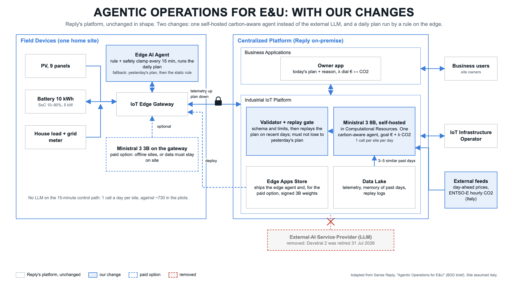
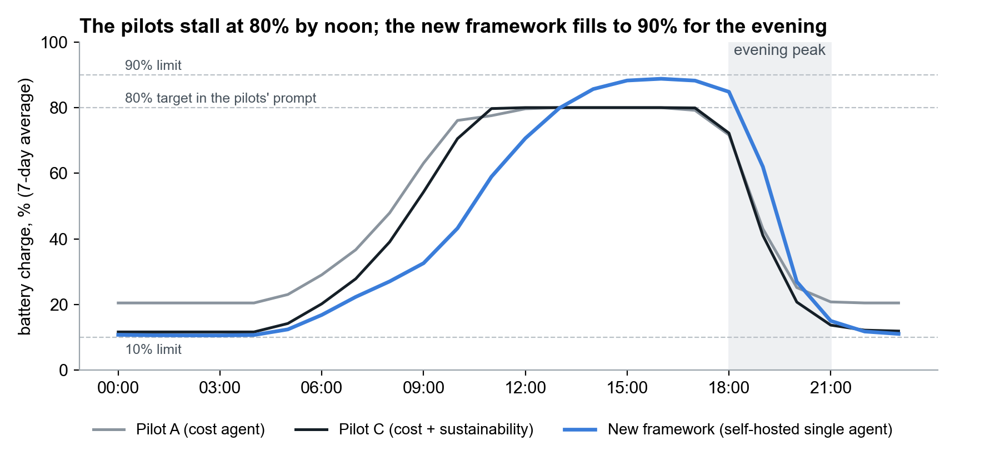
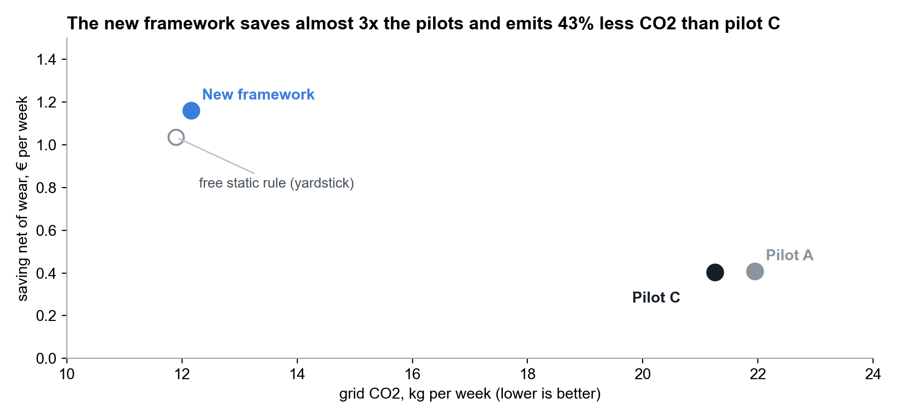

<!-- Source of the .docx. Build: see the last line of this file. Numbers: data/Sense_Reply_B2_KPI_Conformity.xlsx and data/ours_ministral.json. -->

## 1. Executive summary

**Keep sustainability as a goal, but drop the second agent.** We replace the two pilot agents with one carbon-aware agent. It plans once a day, a rule runs the battery every 15 minutes, and the agent runs on an open-weight model that Reply hosts itself (Ministral 3 8B). On the pilot week this turns a net weekly loss of €7.31 (pilot C) into a gain of €0.98, and it cuts the AI bill from €7.71 to €0.18 per site per week.

We compare three scenarios, all on the same house, sun and prices:

- **Pilot A**: orchestrator plus a cost agent (observed).
- **Pilot C**: orchestrator plus a cost agent and a sustainability agent (observed).
- **New framework (self-hosted single agent)**: one carbon-aware agent with a daily plan, run by a rule (modelled on run C's sun, load and prices).

A free **static rule** (charge on solar surplus, discharge when the house needs power) is the yardstick, not a scenario. A controller that cannot beat it has no reason to exist.

| KPI (per site, per week) | Pilot A | Pilot C | New framework |
|---|---|---|---|
| Saving vs no battery, net of wear | €0.41 | €0.40 | €1.16 |
| Value over the free rule, before AI cost | −€0.73 | −€0.67 | +€0.12 |
| AI cost | €4.74 | €7.71 | €0.18 |
| **Net value after AI cost (N1)** | **−€4.33** | **−€7.31** | **+€0.98** |
| Grid CO2 | 21.9 kg | 21.3 kg | 12.2 kg |
| LLM calls per day | ~420 | ~730 | 1 |

**Where the pilots go wrong.** A fixed 80% charge target fills the battery by late morning. Midday solar is then exported at about €0.09/kWh and bought back at €0.11–0.12 in the evening. Both prompts value export at zero. The sustainability agent gets no price and no CO2 data, so it can only push "import less". Two agents setting one number add LLM calls but no information. The AI bill is 8 to 12 times what the battery saves.

**What the second agent buys.** Pilot C costs €2.97 a week more than A and avoids 0.7 kg of CO2: about €4,300 per tonne, 48 times the EU carbon price (~€90/t). A carbon weight inside one agent costs nothing extra in our model: it was slightly cheaper and cleaner this week.

**The model.** Devstral 2, which ran the pilots, was retired on 31 July 2026. We pick **Mistral Ministral 3**: open weights, Apache-2.0, EU origin, so Reply holds the file and no vendor can retire it.

- The **8B** runs on Reply's own platform. That is the default, and it is what the numbers above assume (1,000 sites, operations included).
- The **3B** can run on the site gateway as a paid option, for sites that must work offline or keep data on site.

**One honest caveat.** Before AI cost, our agent beats the free rule by €0.12 a week. At 1,000 sites the self-hosted model costs €0.18, so after AI cost we are €0.06 a week behind the rule (KPI F1). We clear the rule from about 1,500 sites, or on an EU API. In this January week the model's value is a reliable daily plan, an explanation and a cost-vs-CO2 dial, not better decisions than the rule. It has to prove decision value on other seasons (§9).

**How far to trust this.** The pilots are measured. The new framework is modelled on the same inputs with a "tomorrow looks like today" forecast. The evidence is one winter week at one site, with a constant carbon factor (0.356 kg/kWh) and a site assumed to be in Italy. Treat it as pilot evidence, not proof.

## 2. Business case and deliverables

**The case (BDD #3, B2 Sense Reply).** An AI-native IoT platform orchestrates energy assets (PV, a home battery, the grid) through a central AI layer and edge gateways on site. Two agent set-ups were piloted. We assess both, price the cost-versus-sustainability trade-off and recommend a better design.

| Deliverable | Where | Companion file |
|---|---|---|
| KPI dashboard comparing the scenarios | §5, §6 | `Sense_Reply_B2_KPI_Conformity.xlsx`; the demo's KPI tab |
| Time-series analysis: agent behaviour, battery, grid | §4 | V4 workbook telemetry sheets |
| Trade-off matrix, cost vs sustainability | §7 | KPI Excel |
| Executive summary and recommendation | §1, §8 | — |
| Framework improvement proposal | §3 | the demo site (one week, played back) |

**Guidance from the briefing.**

- Any AI approach is open, including a new framework.
- Carbon data should update automatically, not be a fixed statistic.
- The client floated paying once for an internal model instead of paying per token, and learning from past cases.
- Sustainability is expected to cost money. Our job is to measure how much and to reduce it.

**What the data cannot tell us.** There is no CO2 field, no log of agent proposals and no contractual grid limit, and only one winter week. The runs also start from different battery levels.

## 3. What we propose

### 3.1 The platform, with our two changes

We keep Reply's "Agentic Operations for E&U" platform as it is and change two things (blue in the figure):

1. **The external LLM is replaced by a self-hosted model.** Ministral 3 8B runs in the platform's own computational resources. The platform is already "cloud or on-premise".
2. **The LLM leaves the 15-minute control path.** The edge agent on the gateway runs a rule plus a safety clamp every 15 minutes, following a plan the central agent writes once a day.

Everything else stays in place:

- **Data Lake:** stores telemetry and the memory of past days.
- **Edge Apps Store:** ships the edge agent and, for the paid option, the signed 3B weights.
- **Business application:** shows the owner the plan and its reason.

{width="6.5in"}

### 3.2 How the agent works

- **One agent, one goal.** It minimises € + λ × kg CO2, where λ is a dial the owner sets (default €0.10 per kg). It sees day-ahead prices and the hourly grid CO2 for Italy (ENTSO-E). It values export at the sell price, and it replaces the fixed 80% target with "keep enough for tonight's evening load".
- **One call a day.** The agent returns three knobs (a minimum charge, an evening reserve in kWh, and the price above which to keep energy rather than export it) plus a two-sentence reason. It never sets kW.
- **A rule executes every 15 minutes, and a clamp has the last word.** The clamp holds charge between 10% and 90% and power within ±5 kW.
- **A validator and a replay gate check every plan.** The plan must pass a schema and limit check. It is then replayed on recent days and must not lose to yesterday's plan.
- **Fallback.** If the plan fails, yesterday's valid plan runs, then the static rule. The battery is never unmanaged, and the worst case is the free rule.
- **Memory without training.** Each evening one row is stored: context, knobs, result, and regret against the rule. Each morning the agent sees the 3–5 most similar past days.

| | Pilots today | Our framework |
|---|---|---|
| Objective | Two agents debate; sustainability has no price and no CO2 | One goal, € + λ × kg CO2, with live hourly CO2 |
| LLM calls | ~730 a day, 4.4–7.6 per 15-min decision | 1 a day |
| Control path | LLM in the loop, 10–18 s per decision | Rule under 1 ms; LLM off the path |
| Export | Valued at zero | Valued at the sell price |
| Battery target | Fixed 80% | Reserve sized on tonight's load |
| Model | Devstral 2 via external API (retired) | Ministral 3 8B, self-hosted by Reply |

### 3.3 Why Ministral 3

- **Governance.** With open weights, Reply holds the model file. Updates become Reply's decision, gated by the replay gate. Devstral 2 was retired mid-project; a hosted model can be retired again.
- **Licence and origin.** Apache-2.0 allows commercial use. EU origin makes procurement and the AI Act story easiest for an Italian client. It is also the same vendor family as Devstral, which eases the port.
- **Fit.** The task is three numbers and two sentences once a day. We ran the week on **Ministral 3 8B on a laptop** (8 GB, 3-bit quantised so it fits), and earlier on the 3B (the memory class of a Jetson Orin Nano):
  - 8B: 21 of 21 plans were valid JSON, with no clamped knobs (three carbon weights × 7 days); the demo replays these plans;
  - 3B: 14 of 14 valid, the same week's saving within half a cent;
  - each call took about 27 s on the laptop (8B) and 12–14 s (3B), which doesn't matter once a day.
- **Where it runs.** The default is the **8B on Reply's platform**. The **3B on the gateway** is a paid option for offline sites or for clients whose data must stay on site. A box per site costs more than the battery saves (§8), so it is not the default.

The 8B ran at 3-bit on a laptop; the costed set-up serves it at full quality on Reply's node. Re-run the week there before go-live.

## 4. How we analysed the data

**1. The data.** There are three runs over the same window: 5 Jan 11:00 to 12 Jan 10:45 2026, in 15-minute steps. Each step covers nine PV panels, one 10 kWh battery (5 kW, usable 10–90%, 95% efficiency each way), one house and one grid connection with buy and sell prices. A third run, B, has much dirtier panels (24 kWh less PV). It is not comparable and is left out.

| Run | Agents | PV (kWh) | Battery start → end | LLM requests |
|---|---|---|---|---|
| A | Orchestrator + cost agent | 93.13 | 57% → 80% | 2,948 |
| C | + sustainability agent | 93.06 | 80% → 70% | 5,118 |

**2. Making it fair.**

- Raw euros are not comparable, because the runs start and end at different charge levels. We correct every bill for the energy left in the battery.
- We rebuild the bill from energy × price, because the data's `cost` field is not a running total.
- We rebuild load from the energy balance, which closes within 0.5%.

**3. Twins.** Each run is scored against counterfactuals built on its own sun, load and prices: the same house with **no battery**, the **free static rule**, and a **perfect-foresight optimiser** (a ceiling, not achievable). The battery model fits the telemetry within 0.08 kW.

**4. Money.** The bill is C_adj = Σ(import × buy price − export × sell price), corrected for the change in stored energy.

- **Saving:** S = no-battery bill − C_adj.
- **Saving net of wear:** S_net = S − €0.005 per kWh discharged. The wear figure comes from BSS.json: €100/kWh replacement × 0.005% health per full cycle.
- **N1 = S_net − AI cost.**
- **AI cost:**
  - pilots: their token counts at the Devstral list price (0.86 €/$);
  - new framework: Ministral 3 8B on a right-sized node on Reply's platform at 1,000 sites, including hardware, power and 0.1 FTE of operations (§8).

**5. Hour by hour.** The pilots charge from 05:00 and then sit at the 80% target from about 11:00 to 17:00. Our agent keeps charging towards 90%, so more solar is left for the evening. The pilots export 43–45 kWh in the week; we export 17 kWh.

{width="6.5in"}

**6. Day by day.** Pilot C is below the rule on all six full days, and pilot A beats it once (9 Jan). The week is very regular: 12.5–14.1 kWh of PV and about 15 kWh of load per full day. A summer week is needed before reading anything into day types.

**7. CO2.** The telemetry has no CO2 field, so we estimate it outside the platform data:

- **Source.** We take ENTSO-E hourly generation per fuel for Italy and weight it with IPCC lifecycle factors. That gives 214–439 g/kWh, with a mean of 356 g over the telemetry hours.
- **The constant.** The KPIs use that mean as a constant 0.356 kg/kWh, credited for energy left in the battery.
- **The hourly check.** The hourly series is used as a check. It shows that the pilots buy at hours about 5% dirtier than average, so the sustainability agent does not time its imports.

**8. AI load.** Pilot A makes 4.4 LLM calls per 15-minute decision and pilot C makes 7.6. That is 18–29k tokens and up to 10–18 s per decision. Latency is not the problem. Cost and the number of failure points on the control path are.

**9. Why the agents lose.**

- The fixed 80% target.
- Export valued at zero.
- A sustainability agent with no price or CO2 input.
- Two agents setting one number.

They lose even though they see 24 hours of simulated data ahead, which is more than a real forecast would give them.

## 5. KPIs

Every KPI has a formula tied to a data field or a named source, a direction and a threshold. The companion Excel marks each one Good or Improvable for A, C and the new framework. Its thresholds are editable.

**Kinds of threshold.**

- **Benchmark:** what the free rule achieves. For example, the rule saves €1.03 a week net, so the saving target is €1.03.
- **Break-even:** for example, net value after AI cost above zero.
- **Design target:** AI cost below 0.2 × saving; fewer than 0.3 LLM calls per decision.
- **Team-defined:** self-use, peak shaving and time at limits. To confirm with the client.

**The groups.**

- **Value:** S_net, VCR (share of the achievable saving captured), VORB (value over the rule).
- **AI economics:** N1, N2 (AI cost per € saved), F1 (value over the rule after AI cost), O5 (AI cost), O1 (calls per decision).
- **Carbon:** S1 (grid CO2), S2b (CO2 vs the rule), MAC (cost per kg avoided).
- **Self-use and grid:** SCR, SSR, PSR, peak import.
- **Battery:** cycles, time at limits, storage efficiency.
- **Price timing:** C5 (share of imports bought at expensive hours).

Win rate, agent agreement and regret cannot be computed on the pilots, because their proposals are not logged. They are listed as not assessable.

## 6. Three scenarios compared

| KPI | Pilot A | Pilot C | New framework | Better |
|---|---|---|---|---|
| S_net: saving vs no battery, net of wear (€/wk) | 0.41 | 0.40 | 1.16 | higher |
| VCR: share of the achievable saving | 0.28 | 0.29 | 0.65 | higher |
| VORB: value over the free rule (€/wk) | −0.73 | −0.67 | +0.12 | higher |
| O5: AI cost (€/wk) | 4.74 | 7.71 | 0.18 | lower |
| N1: net after AI cost (€/wk) | −4.33 | −7.31 | +0.98 | higher |
| N2: AI cost per € saved | 7.84 | 12.24 | 0.12 | lower |
| F1: value over the rule after AI cost (€/wk) | −5.47 | −8.38 | −0.06 | higher |
| S1: grid CO2 (kg/wk) | 21.9 | 21.3 | 12.2 | lower |
| S2b: CO2 avoided vs the rule (kg/wk) | −10.0 | −9.4 | −0.3 | higher |
| SCR: self-consumption of PV | 0.52 | 0.54 | 0.82 | higher |
| SSR: self-sufficiency | 0.39 | 0.44 | 0.69 | higher |
| PSR: peak shaving | 0.00 | 0.39 | 0.54 | higher |
| Peak grid import (kW) | 4.81 | 2.93 | 2.20 | lower |
| Grid import / export (kWh/wk) | 63.8 / 45.1 | 58.7 / 42.9 | 32.3 / 16.7 | — |
| Equivalent full cycles (per wk) | 4.3 | 4.7 | 5.4 | lower |
| Time at charge limits | 0% | 0% | 29% | lower |
| C5: expensive-import share | 0.81 | 0.80 | 0.77 | lower |
| O1: LLM calls per 15-min decision | 4.39 | 7.62 | 0.01 | lower |

For reference, the free rule saves €1.03 a week net and emits 11.9 kg. The new framework is modelled on run C's inputs with a starting charge of 80% and λ = €0.10/kg.

{width="6.5in"}

**What the comparison shows.**

- **The pilots are dominated.** They lose to the free rule on every value KPI, and their AI bill is 8 to 12 times the saving.
- **The new framework turns the economics positive.** Saving is almost 3× pilot C's, and the AI bill is 98% lower. Net value goes from −€7.31 to +€0.98 a week.
- **The new framework is much cleaner.** Grid import falls 44% and grid CO2 43% against pilot C. It sits next to the rule: 0.3 kg a week dirtier, €0.12 richer before AI cost. It also has the lowest grid peak of the three (2.2 kW).
- **Where it is weaker.** The battery sits at its limits 29% of the time, because the 80% cap is gone. Cycles are 5.4 a week, still below a 7-cycle limit.
- **Most of the gain is design, not intelligence.** Dropping the 80% target and valuing export does most of the work. We say so before anyone else does.

## 7. Trade-off: cost against sustainability

### 7.1 Matrix

Ratings are strong, medium or weak, on the week analysed.

| | Pilot A | Pilot C | New framework |
|---|---|---|---|
| Net saving | Weak: €0.41 | Weak: €0.40 | Strong: €1.16 |
| Value over the free rule | Weak: −€0.73 | Weak: −€0.67 | Medium: +€0.12 before AI, −€0.06 after |
| AI cost | Weak: €4.74/wk | Weak: €7.71/wk | Strong: €0.18/wk |
| Grid CO2 | Weak: 21.9 kg | Weak: 21.3 kg | Strong: 12.2 kg |
| Peak on the grid connection | Weak: 4.8 kW | Strong: 2.9 kW | Strong: 2.2 kW |
| Battery stress | Strong: 0% at limits | Strong: 0% at limits | Medium: 29% at limits |
| Failure points | Weak: LLM on the control path | Weak: two agents on the path | Strong: rule + clamp, fallback chain |
| Who controls the model | Weak: external API, retired | Weak: external API, retired | Strong: open weights, held by Reply |
| Evidence | Observed | Observed | Modelled |

### 7.2 What a kilogram of CO2 costs

- **A second agent:** about €4,300 per tonne (pilot C against A: +€2.97 a week for −0.7 kg). That is 48 times the EU ETS price of about €90/t. On hourly carbon it is still about €2,000/t.
- **A carbon weight inside one agent:** free in this week. Moving λ from 0 to €0.10/kg avoided 0.85 kg and saved about €0.01 (MAC −€0.011/kg). That gap is within the gate's noise, so read it as "about zero", far below the carbon price.
- **Conclusion.** Carbon should be a parameter of one agent's goal, not a second agent.

### 7.3 Sensitivities

| Assumption | Base | If it changes |
|---|---|---|
| Fleet size | 1,000 sites | AI cost per site: €1.76 at 100 sites, €0.018 at 10,000 (§8). Below ~1,000 sites, start on an EU API. |
| Wear cost | €0.005/kWh (BSS.json) | The pilots lose all their saving at ~€0.015/kWh. |
| Carbon factor | 0.356 kg/kWh constant | Hourly carbon moves absolute CO2 by ~8%; the ranking does not change. |
| Forecast | 24 h "same as yesterday" | A real forecast error would cut some of the gain. |
| Season | One winter week | Summer has more PV and less evening need. Re-run before any promise to a client. |

## 8. Business impact

### 8.1 AI cost per site: where the model runs

The token volume is measured on the Ministral 3 bench: about 12k in and 1.1–1.3k out per site per week, at one call a day. Hardware is amortised over 5 years. Power is priced at €0.32/kWh. Operations are 0.1 FTE (estimate). The script is `analysis/model_cost.py`.

| Where the model runs | AI cost, € per site per week (100 / 1,000 / 10,000 sites) | N1, € per week (100 / 1,000 / 10,000 sites) |
|---|---|---|
| **Ministral 3 8B on Reply's platform (default)** | 1.76 / **0.18** / 0.018 | −0.60 / **+0.98** / +1.14 |
| Same model on an EU API (small fleets) | 0.67 / 0.069 / 0.008 | +0.48 / +1.09 / +1.15 |
| Ministral 3 3B on a gateway box (paid option) | 1.86 per site at any fleet size | −0.70 |
| Pilot C, for reference | 7.71 | −7.31 |

- **The model is nearly free; people and boxes are not.** Operations are about three quarters of the on-prem figure at 1,000 sites. If Reply already runs the compute and an MLOps team, the marginal cost falls to about €0.04 a site a week.
- **Self-hosting is the price of governance, not a saving.** At 1,000 sites the EU API is about €0.11 a site a week cheaper. What self-hosting buys is control: Reply owns the model, no vendor can retire it, and data stays on Reply's platform.
- **Start small on an API, move in-house at ~1,000 sites.** The weights and the prompt are the same, so the move is a config change.
- **The edge box is a premium, not a saving.** It costs €97–422 per site per year against a gain of about €51. Price the offline and data-residency option at or above that floor.

### 8.2 Unit economics

| | Pilot A | Pilot C | New framework |
|---|---|---|---|
| Net value per week after AI cost | −€4.33 | −€7.31 | +€0.98 |
| Indicative per year (× 52, winter week) | about −€225 | about −€380 | about +€51 |
| LLM calls per site per day | ~420 | ~730 | 1 |

- **The pilot design does not scale.** Its cost grows with every site and exceeds the saving 8–12×, so each new customer adds a loss.
- **The new framework changes the cost structure.** Inference becomes a shared fixed cost that shrinks per site as the fleet grows.
- **The value per site is small in euros.** On a 10 kWh home battery the saving is tens of euros a year. The business case rests on fleet orchestration, grid services and CO2 reporting, which this dataset cannot test.

## 9. Recommendation and roadmap

**Recommendation: one carbon-aware agent on Ministral 3 8B, self-hosted, writing a daily plan that a rule and a clamp execute.** It removes the three causes of failure (the 80% target, unvalued export, the LLM on the control path), turns carbon into a priced dial, and puts the model under Reply's control. Its worst case is the free rule.

| Phase | When | Work | Gate to pass |
|---|---|---|---|
| 0. Fix the baseline | Weeks 1–2 | Make the free rule and no-battery twin standard KPIs; log agent proposals; drop the 80% target | Rule reproduced within 1% |
| 1. Prove decision value | Weeks 3–6 | Replay summer, spring and price/CO2-spike weeks; run the 8B once on our prompts | Beats the memory-only baseline and the rule on at least one season, N2 < 0.2 |
| 2. Carbon desk | Weeks 5–8 | Hourly ENTSO-E carbon feed in production; λ calibration with the client | Carbon cost per tonne below the EU price |
| 3. Pilot sites | Months 3–5 | Switch a small group of sites, on an EU API first; owner sees plan and reason | Clamp and override rates below agreed limits |
| 4. In-house and scale | Month 6 onward | Move the model to Reply's platform at ~1,000 sites; offer the 3B gateway option | Unit economics confirmed on a full year |

If the model never beats the memory-only baseline, ship the rule with the daily plan logic, and keep the LLM for the owner's explanation.

## 10. Limits and what we corrected

**Limits we state openly.**

- One winter week, one site, 672 steps. The new framework is modelled, not observed, with a persistence forecast. It is probably optimistic.
- The simulated PV peaks at 10:00 with about 14 hours of sun in January. That is not real Italian weather.
- Carbon is an average intensity, not marginal, and imports are not in the ENTSO-E production mix.
- The AI cost of the self-hosted model is an estimate: €4k node, 0.1 FTE of operations, 1,000 sites. Confirm with Sense Reply.
- In this week, plans from Ministral 3 8B, the 3B, a cloud model and "copy the most similar good day" give the same result within half a cent. On 5 of 7 days (λ 0.10) the replay gate kept the previous plan. The model's decision value is not yet shown.

**What we corrected from earlier documents.**

| Point | Issue | Correction |
|---|---|---|
| LLM price (Devstral 2) | Assumed list price; model retired 31 Jul 2026 | Priced the named replacement, Ministral 3 8B self-hosted, with operations |
| Two modes of the new design | Hard to explain; the grid-charging mode raised CO2 and the peak | One recommended design; grid charging dropped |
| Pilot B | Dirtier panels, not comparable | Removed from the comparison |
| Wear €0.10/kWh | Not supported by BSS.json | €0.005/kWh derived |
| Carbon 350 g/kWh (V4 report) | Illustrative | 0.356 kg/kWh constant, hourly series as check |

## Sources

- Project data: DatasetV4 (runs A and C), DataIndex.xlsx, Assets/BSS.json, Prompts, DATA_MODEL.pdf.
- Companion files: `data/Sense_Reply_B2_KPI_Conformity.xlsx`, `data/ours_ministral.json`, `analysis/model_cost.py`, `docs/research/08-local-model-choice.md`.
- ENTSO-E Transparency Platform, aggregated generation per type, Italy; IPCC AR5 lifecycle emission factors.
- Mistral Ministral 3 model cards (Hugging Face, Apache-2.0).
- EU ETS price: EUA Dec-2026 about €90/t (market reports, November 2026).

<!-- Build: cd docs && pandoc REPORT.md --resource-path=. --reference-doc="Sense Reply BDD B2 – Full Analysis Report FINAL.docx" -o "Sense Reply BDD B2 – Full Analysis Report FINAL.docx" -->
